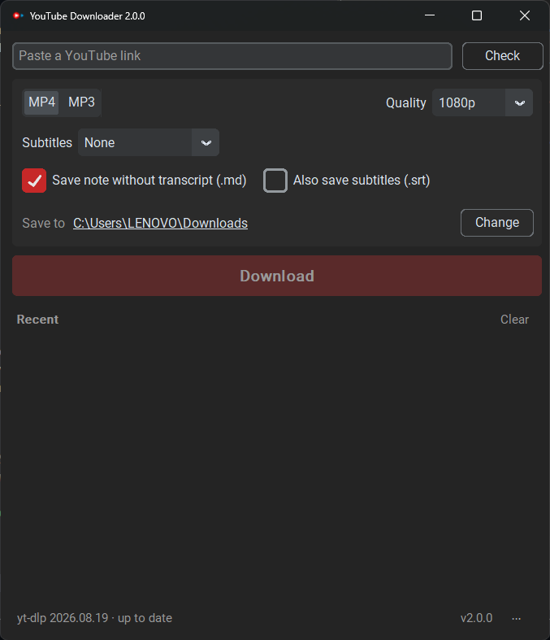
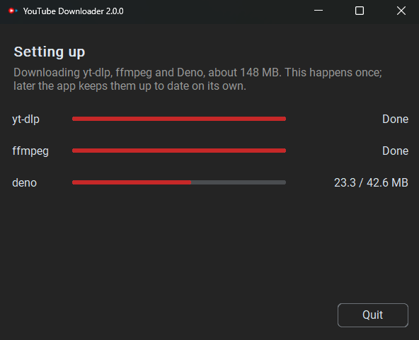

# YouTube Downloader

Save a YouTube video as an MP4 together with a Markdown note and a transcript built from
YouTube's own captions. The note is a plain Markdown file next to the video: it embeds the video
and carries the description, chapters and a timestamped transcript.

A window for Windows and Linux, plus a command line for scripts and AI agents (Linux / WSL).
**YouTube only**, one video at a time.



## Contents

- [What you get](#what-you-get)
- [Legal notice](#legal-notice)
- [Installation](#installation)
- [Using the window](#using-the-window)
- [How it works](#how-it-works)
- [Command line (Linux / WSL)](#command-line-linux--wsl)
- [Troubleshooting](#troubleshooting)
- [Files, folders and uninstalling](#files-folders-and-uninstalling)

## What you get

For every video, in the folder you choose:

| File | What it is |
|---|---|
| `Title.mp4` | The video, H.264 + AAC where YouTube offers it (plays everywhere), up to 1080p by default. Or MP3 audio instead. |
| `Title.md` | A note: metadata, the embedded video, description, chapters and the transcript with clickable timestamps. |
| `Title.<lang>.srt` | Optional subtitles, when you tick **Also save subtitles (.srt)**. |

A note, shortened (placeholder values):

```markdown
---
title: "Video title"

channel: "Channel name"

url: https://www.youtube.com/watch?v=VIDEO_ID

published: 2026-10-01

downloaded: 2026-10-18

duration: "26:02"

video: "[[Video title.mp4]]"

transcript: youtube-manual-en

tags: [video, youtube]

---

# Video title

![[Video title.mp4]]

## Description
…
## Chapters
- [00:00](https://youtu.be/VIDEO_ID?t=0) Intro
…
## Transcript
[00:00](https://youtu.be/VIDEO_ID?t=0) First paragraph of the transcript…
```

## Legal notice

**This application is a technical tool. You are responsible for the legality of what you
download.** Fine: your own videos, Creative Commons and public-domain content, backups of your
own materials, educational fair use. Not fine: others' content without the author's consent,
commercial distribution, any copyright infringement. Respect copyright and the
[YouTube Terms of Service](https://www.youtube.com/t/terms).

## Installation

Requirements: Windows 10 / 11 or Linux (Ubuntu 22.04+ / Debian 12+), 64-bit, internet with IPv4.
Packages are on [Releases](https://github.com/george7979/youtube-downloader/releases).

### Windows

Run `youtube-downloader-X.X.X-setup.exe`. It adds a Start Menu shortcut and a desktop icon; a new
version installs over the old one and keeps your settings. The Windows app has no command line.

> The installer is **not digitally signed**, so Windows may say "Windows protected your PC".
> Click **More info** → **Run anyway**. The full source code is in this repository.

### Linux — .deb package

```bash
sudo apt install ./youtube-downloader_X.X.X_amd64.deb
youtube-downloader          # opens the window
```

With a system `ffmpeg` (a recommended package) the app uses it; otherwise it downloads its own.

### Linux / WSL — from the repository (command line)

```bash
sudo apt install python3-tk     # Tk for the window
uv tool install --python /usr/bin/python3 /path/to/youtube-downloader
youtube-downloader tools        # checks the setup, downloads missing tools
```

This needs a system Python 3.12+ (Ubuntu 24.04 and later). On older systems use
`uv tool install --managed-python --python 3.12 …`: the command line is the same, but uv's own
Python draws the window with a plain bitmap font and letters instead of arrows and check marks.

### First run

The download tools are not bundled (see [Tools and updates](#tools-and-updates)). On the first
start the app downloads them, checks their SHA-256 checksums and shows progress: about 150 MB on
Windows, 60 MB on Linux with a system ffmpeg, 210 MB without. If it fails, the window shows the
error and **Retry**.



## Using the window

1. **Paste a YouTube link.** The app checks it at once and shows the title, channel, length,
   date, thumbnail and subtitles. For a typed link, or to try again, click **Check**.
2. **Choose:** **MP4** or **MP3**, **Quality**, the **Subtitles** track for the transcript,
   **Save note with transcript (.md)** ("without transcript" when Subtitles is None) and
   **Also save subtitles (.srt)**.
3. **Save to** — your Downloads folder at first; click the path to open it, **Change** to pick
   another. The folder and your choices are remembered.
4. **Download.** A progress bar and a status line show each step; **Cancel** stops and removes
   partial files. You can check the next link while a download runs.

If the video is already in the folder and you picked another subtitle language, **Add transcript**
saves a note in that language without downloading the video again.

**Recent** lists the last three downloaded files with their format — the MP4 and the MP3 of one
video are two rows (**Show file**, **Clear** — files stay on disk). The footer shows the engine
version; the **⋯** menu has **Update engine**, **Open log folder** and **About**.

## How it works

### Tools and updates

The app drives three tools, downloaded from their official releases into your profile and
verified against the published checksum; a tool is replaced only once the new copy is complete.

| Tool | Role |
|---|---|
| [yt-dlp](https://github.com/yt-dlp/yt-dlp) | Reads the page and downloads the streams — the engine. |
| [ffmpeg](https://github.com/yt-dlp/FFmpeg-Builds) | Merges video and audio into one MP4, makes MP3s. On Linux a system ffmpeg is used when installed. |
| [Deno](https://deno.com) | Lets yt-dlp solve YouTube's JavaScript challenges. |

YouTube changes often and an old yt-dlp stops working, so:

- **At most once a day**, when the window starts (or before `get` / `info`), yt-dlp updates in
  the background; the footer says *updated*, *up to date* or *update failed*. A download started
  meanwhile waits for it. A failed update is retried at the next start; the app keeps working.
- **Update engine** (⋯ menu, and next to errors it may fix) updates yt-dlp now, reinstalls it if
  it no longer runs, and refreshes ffmpeg and Deno. Not available during a download.

### Video and audio

- **MP4:** the best stream up to the chosen height, preferring H.264 + AAC. Without H.264 at that
  height (some 4K videos) the app uses VP9/AV1 and says so — some players can't play those.
- **Quality is a ceiling:** a video that only goes up to 720p comes in 720p; your setting stays.
- **MP3:** the best audio, converted at 192 kbit/s.

### Subtitles and the transcript

The transcript comes from captions YouTube already has; the app transcribes nothing.

- **Offered tracks:** every manual (uploaded) language, plus automatic captions in the spoken
  language. YouTube's machine translations are never offered.
- **Default track:** your last language if the video has it; else manual subtitles in the
  video's language; else the first manual track; else automatic captions. Manual beats automatic
  in the same language. **None** saves the note without a transcript.
- **Building it:** repeated lines of automatic captions are removed; text is joined into
  paragraphs of about 45 s ending on a full sentence (at most 90 s), with a new paragraph at
  every chapter. Each paragraph starts with its time (`mm:ss`, or `h:mm:ss` from an hour) as a
  link to that moment on YouTube.
- `transcript:` in the note says the source: `youtube-manual-<lang>`, `youtube-auto-<lang>` or
  `none`. The `.srt` comes from the same track, cleaned the same way.

### The note

- The header holds title, channel, link, publication and download dates, length, a link to the
  video, the transcript source and the tags `video` and `youtube` — note properties in apps that
  read YAML frontmatter, one field per line elsewhere.
- `![[Title.mp4]]` embeds the video by file name — it plays in apps that support wiki links
  (e.g. Obsidian); elsewhere it shows as text.
- Title, description, chapters and transcript come from the video's author, so they stay plain
  text: `#`, brackets, `<`, backticks and `~` are escaped. No tags, images, links, HTML or code
  blocks appear that YouTube did not show; plain URLs stay clickable.
- `Title.<lang>.md`: a full note in another language (same header plus `main_note:` linking to
  `Title.md`), added without downloading the video again when you pick subtitles in a language
  the main note doesn't have. Your existing notes are never changed.
- **An existing note is never overwritten or deleted** — your edits are safe.

### File names and downloading again

Files are named after the title (characters Windows forbids replaced, long titles shortened). If
that name belongs to a different video, the new files get the ID: `Title [AbCdEfGhIjK].mp4`.
Nothing is ever overwritten. A video already in the folder is recognised by its note (`url:`) or
the ID in a file name — never by the title alone:

| In the folder | What happens |
|---|---|
| video + note | "Already downloaded" — **Show file** or **Download again** |
| video + note, subtitles in another language picked | also **Add transcript** → `Title.<lang>.md`, only the subtitles are downloaded |
| note, no video | downloads the video, keeps your note |
| video with `[ID]`, no note | writes only the note |
| `Title.mp4` without a note | treated as another video → `Title [ID].mp4` |

MP4 and MP3 are separate: having the MP4 doesn't block an MP3 of the same video.

### Connection and reliability

- **IPv4 only:** YouTube sometimes flags a home IPv6 address ("Sign in to confirm you're not a
  bot") while the same computer's IPv4 works.
- **HTTP 403** from a stream is retried once with fresh links; you see an error only if that
  fails too.
- **Pauses:** YouTube sometimes holds each ~10 MB piece for ~20 s, so a download moves in steps.
  It varies with the time of day; the log records every pause over 15 s.
- **Limits:** many videos in a row (about 300 an hour) trigger `rate_limit` — wait a few minutes.

## Command line (Linux / WSL)

The same for scripts and AI agents: no command ever asks a question, and with `--json` the
result is one JSON object on stdout.

```bash
youtube-downloader get <URL> --out DIR [--quality 1080] [--audio] [--subs LANG|none]
                             [--srt] [--no-note] [--force] [--json]
youtube-downloader info <URL> [--json]
youtube-downloader tools [--update] [--json]
```

- `get` downloads and writes the note. `--audio` = MP3; `--subs pl` picks a language (manual
  before automatic), `--subs none` skips captions; without `--subs` the default rules above apply
  (no remembered language). An existing video + note is reported and skipped unless `--force`.
  `--subs pl` on a video that is already here with its note writes `Title.pl.md` next to it
  instead — the JSON's `note` points to that file and `transcript` is `youtube-<kind>-pl`.
- `info` shows metadata, heights and caption tracks without downloading.
- `tools` shows tool paths and versions; `--update` works like **Update engine**.
- It never asks questions and never uses the window's folder — pass `--out` every time. `get` and
  `info` update yt-dlp at most once a day first (warn and carry on if that fails).
- Progress goes to stderr; with `--json`, stdout is exactly one JSON object:

```json
{"ok": true, "video_id": "AbCdEfGhIjK", "title": "...", "media": "/path/Title.mp4",
 "note": "/path/Title.md", "srt": null, "transcript": "youtube-auto-pl",
 "already_exists": false, "warnings": []}

{"ok": true, "video_id": "...", "title": "...", "channel": "...", "url": "...",
 "duration": 3935, "published": "2020-07-01", "heights": [720, 360, 144],
 "subtitles": [{"lang": "pl", "kind": "auto"}]}

{"ok": true, "tools": {"yt-dlp": {"path": "...", "version": "2026.10.18"},
 "ffmpeg": {"path": "..."}, "deno": {"path": "..."}}, "updated": null}

{"ok": false, "error": {"code": "unavailable", "message": "...", "hint": "...", "details": "..."}}
```

- **`get`:** `already_exists: true` means nothing was downloaded and the paths point to the
  existing files; `transcript` is then `"none"` (the note wasn't rebuilt and may well have one).
  With `--no-note` and an existing video, `note` is `null`.
- **`info`:** `duration` in seconds, `published` an ISO date (both may be `null`), `heights`
  highest first, `kind` is `manual` or `auto`.
- **`tools`:** `ffmpeg.path` is the folder with `ffmpeg` and `ffprobe`. `updated` is `null`
  without `--update`, else `{"from": "<old>", "to": "<new>"}`; `"to": null` = update failed.
- **Exit codes:** `0` success, `1` error, `2` wrong usage (stderr, no JSON), `130` Ctrl+C.

A ready-made skill for Claude Code is in `integrations/claude-skill/`; other agents can use the
commands above directly.

## Troubleshooting

Every error says what happened and what to do; **Show details** gives the technical text for a
bug report. The command line returns the same `code`.

| Code | Meaning | What to do |
|---|---|---|
| `invalid_url` | Not a YouTube video link. | Paste a `https://www.youtube.com/watch?v=...` link. No playlists. |
| `unavailable` | Private, removed, age-restricted, members-only or region-blocked. | Check the link. Logging in is not supported. |
| `network` | No connection to YouTube (or to GitHub while installing tools). | Check your connection and retry. |
| `bot_check` | YouTube suspects automated access (VPNs, office networks). | **Update engine** (`tools --update`), retry, or wait. |
| `engine_outdated` | YouTube changed and yt-dlp can't read the video. | **Update engine** (`tools --update`) and retry. |
| `forbidden` | Stream refused (HTTP 403), already retried once. | Retry; if it persists, **Update engine**. |
| `rate_limit` | Too many requests. | Wait a few minutes. |
| `write_failed` | Folder not writable or disk full. | Pick another folder or free space. |
| `tools_missing` | A tool is missing, incomplete or failed its checksum. | Restart online, or run `youtube-downloader tools`. |
| `cancelled` | You cancelled. | Nothing; partial files were removed. |
| `unknown` | Anything else. | Attach **Show details** (`error.details`) to a bug report. |

- **Log:** ⋯ → **Open log folder**. It records yt-dlp warnings, pauses over 15 s and total time
  — attach it to reports about slow downloads.
- **Linux app won't start:** `sudo apt reinstall youtube-downloader`; dependency errors:
  `sudo apt-get install -f`.

Bugs and ideas: [GitHub Issues](https://github.com/george7979/youtube-downloader/issues).

## Files, folders and uninstalling

| What | Windows | Linux |
|---|---|---|
| Settings, recent list | `%APPDATA%\YouTube Downloader\` | `~/.config/youtube-downloader/` |
| Tools | `%LOCALAPPDATA%\YouTube Downloader\tools\` | `~/.local/share/youtube-downloader/tools/` |
| Log `app.log` | `%LOCALAPPDATA%\YouTube Downloader\Logs\` | `~/.local/state/youtube-downloader/log/` |

**Windows:** Settings → Apps. The uninstaller removes the program, tools, settings, recent list
and logs. **Linux:** `sudo dpkg -P youtube-downloader` removes the program; settings, tools and
logs stay in the folders above (delete them by hand). Your videos and notes are never removed.

Building from source: [docs/BUILDING.md](docs/BUILDING.md).
