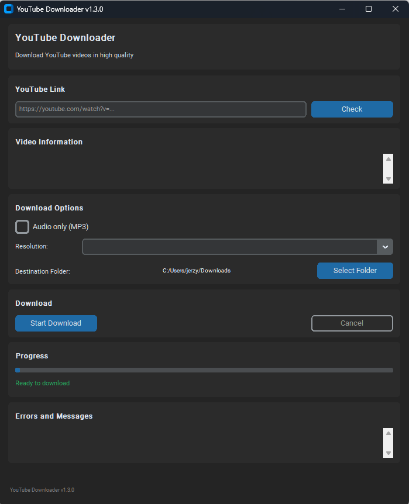

# YouTube Downloader

Save a YouTube video as an MP4 file together with a Markdown note and a transcript built from
YouTube's own captions. Made for keeping videos in an Obsidian vault: the note sits next to the
video, embeds it, and carries the description, chapters and a timestamped transcript.

The app has a graphical window (Windows and Linux) and a command line for scripts and for
Claude Code (Linux / WSL). It works with **YouTube only**.



## What you get

For every video, in the folder you choose:

- `Title.mp4` — H.264 + AAC where YouTube offers it (plays everywhere), up to 1080p by default.
  MP3 audio is available as an option.
- `Title.md` — a note with the video's metadata, the embedded video (`![[Title.mp4]]`), the
  description, chapters, and the transcript as paragraphs with clickable timestamp links to
  YouTube. An existing note is never overwritten.
- `Title.<lang>.srt` — optional, if you tick "Also save .srt".

The transcript comes from YouTube captions: manual ones are preferred, automatic ones are used
as a fallback. Videos without captions get a note without a transcript (`transcript: none`).

## Legal notice

**This application is a technical tool. The user is responsible for the legality of downloading
content.**

Allowed use:
- Your own YouTube content (authors can download their own videos)
- Content under Creative Commons licenses, public domain
- Backup of your own materials
- Educational use within fair use

Prohibited use:
- Downloading others' content without the author's consent
- Commercial distribution of downloaded content
- Copyright infringement

Respect copyright and the [YouTube Terms of Service](https://www.youtube.com/t/terms).

## Installation

System requirements: Windows 10 / 11, or Linux (Ubuntu 22.04+ / Debian 12+), 64-bit.

### Windows — installer

1. Download `youtube-downloader-X.X.X-setup.exe` from
   [Releases](https://github.com/george7979/youtube-downloader/releases).
2. Run it. It creates a Start Menu shortcut and a desktop icon.

> **Windows SmartScreen warning**
>
> The installer is **not digitally signed** (code signing certificates cost about $300 a year).
> Windows may show a "Windows protected your PC" warning. To install anyway:
> 1. Click **"More info"**
> 2. Click **"Run anyway"**
>
> The application is open source — you can review the full source code in this repository.

The Windows app is windowed only; it has no command line (started with a command such as
`get`, it shows a message and exits).

### Linux — .deb package

```bash
sudo apt install ./youtube-downloader_X.X.X_amd64.deb
youtube-downloader          # opens the window
```

`ffmpeg` is a recommended package; if it is not installed the app downloads its own copy.

### Linux / WSL — from the repository (for Claude Code)

```bash
uv tool install --managed-python --python 3.12 /path/to/youtube-downloader
youtube-downloader tools    # checks the setup, downloads missing tools
```

`--managed-python` matters: a system Python often lacks `tkinter`, which the window needs.

## First run

yt-dlp, Deno and (on Windows, or on Linux without a system ffmpeg) ffmpeg are not bundled. On the
first start the app downloads the official builds and checks their SHA-256 checksums, showing
progress for each tool. About 140 MB on Windows, about 60 MB on Linux with a system ffmpeg
(about 210 MB without). This needs an internet connection once; if the connection fails, the
window says so and offers **Retry**.

Afterwards the app updates yt-dlp by itself at most once a day, so it keeps working when YouTube
changes; if an update fails (for example offline), the next start tries again. The footer shows
the current yt-dlp version; the `...` menu has **Update engine**, which refreshes all tools on
demand and reinstalls yt-dlp if it no longer runs. The same button appears next to errors an
engine update may fix.

## Using the window

1. Paste a YouTube link and click **Check** — you see the title, channel, length and thumbnail.
2. Choose **MP4** or **MP3**, the **quality**, and the **subtitles** language (the kind, manual
   or auto, is shown). Tick **Save note (.md)** and, if you want it, **Also save .srt**.
3. The folder defaults to your system Downloads folder; **Change** picks another one. It is
   remembered between sessions.
4. Click **Download**. The status line always shows what is happening (fetching, downloading,
   merging, writing the note). **Cancel** stops it and removes partial files.

If the video is already in the folder the app says so and offers **Show file** or
**Download again**. If only the MP4 is missing, it fetches the MP4 and leaves your note alone.
MP4 and MP3 are separate: having the MP4 does not stop an MP3 download of the same video.
The quality you pick is remembered as a ceiling — a video that only goes up to 720p does not
lower it for the next one. The last five downloads are listed under "Recent downloads"; **Clear** empties the list
(the files stay on disk).

## Command line (Linux / WSL)

The command line never asks questions and never uses the folder saved by the window: you pass
the folder every time. Like the window, `get` and `info` update yt-dlp at most once a day before
they start (a status line on stderr; if the update fails they warn and carry on).

```bash
youtube-downloader get <URL> --out DIR [--quality 1080] [--audio] [--subs LANG|none]
                             [--srt] [--no-note] [--force] [--json]
youtube-downloader info <URL> [--json]
youtube-downloader tools [--update] [--json]
```

- `get` downloads the video and writes the note. `--audio` makes an MP3, `--subs pl` picks a
  caption language, `--subs none` skips captions, `--force` downloads again even if the files
  exist. Without `--force`, an existing video + note is reported and nothing is downloaded.
- `info` shows the metadata, available heights and caption tracks, without downloading.
- `tools` shows the tool paths and versions; `--update` updates them.
- Progress goes to stderr. With `--json` stdout carries exactly one JSON object.

Success from `get --json`:

```json
{"ok": true, "video_id": "VIw16SXObUQ", "title": "...",
 "media": "/path/Title.mp4", "note": "/path/Title.md", "srt": null,
 "transcript": "youtube-auto-pl", "already_exists": false, "warnings": []}
```

`transcript` is `youtube-manual-<lang>`, `youtube-auto-<lang>` or `none`. `already_exists: true`
means nothing was downloaded and the paths are the existing files; `transcript` is then always
`"none"` because the note was not rebuilt (the existing note may well contain a transcript).
With `--no-note` and the video already in the folder, `note` is `null`.

`info --json`:

```json
{"ok": true, "video_id": "VIw16SXObUQ", "title": "...", "channel": "...",
 "url": "https://www.youtube.com/watch?v=VIw16SXObUQ", "duration": 3935,
 "published": "2020-07-01", "heights": [720, 360, 144],
 "subtitles": [{"lang": "pl", "kind": "auto"}]}
```

`duration` is in seconds and `published` an ISO date; both can be `null`. `heights` are the
available video heights, highest first; `kind` is `manual` or `auto`.

`tools --json`:

```json
{"ok": true,
 "tools": {"yt-dlp": {"path": "...", "version": "2026.10.18"},
           "ffmpeg": {"path": "..."}, "deno": {"path": "..."}},
 "updated": null}
```

`ffmpeg.path` is the folder holding `ffmpeg` and `ffprobe`. `updated` is `null` without
`--update`; with it, `{"from": "<old>", "to": "<new>"}`, where `"to": null` means the yt-dlp
update failed.

Failure (any command):

```json
{"ok": false, "error": {"code": "unavailable", "message": "...", "hint": "...", "details": "..."}}
```

Exit codes: `0` success, `1` error, `2` wrong usage (argparse prints to stderr, no JSON),
`130` cancelled with Ctrl+C.

### Claude Code skill

`integrations/claude-skill/youtube-downloader/SKILL.md` teaches Claude Code to use the command
line. Copy that folder to `~/.claude/skills/youtube-downloader/`. The skill always asks you for
the destination folder first.

## Troubleshooting

| Error code | What it means | What to do |
|---|---|---|
| `invalid_url` | The text is not a YouTube video link. | Paste a link like `https://www.youtube.com/watch?v=...`. Playlists are not supported. |
| `unavailable` | Private, removed, age-restricted, members-only or region-blocked video. | Check the link or try another video. Logging in is not supported. |
| `network` | No connection to YouTube (or, while installing the tools, to GitHub). | Check your internet connection and try again. |
| `bot_check` | YouTube suspects automated access (common on VPNs and office networks). | Click **Update engine** (`youtube-downloader tools --update`) and try again, or try again later. |
| `engine_outdated` | YouTube changed something and yt-dlp can no longer read the video. | Click **Update engine** (`youtube-downloader tools --update`) and try again. |
| `rate_limit` | Too many requests. | Wait a few minutes. |
| `forbidden` | YouTube refused the video stream (HTTP 403). The app already retried once. | Try again; if it keeps happening, click **Update engine** (`youtube-downloader tools --update`). |
| `write_failed` | The folder is not writable or the disk is full. | Pick another folder or free up space. |
| `tools_missing` | Download tools are missing, or a downloaded tool failed its checksum or was incomplete. | Restart the app while online, or run `youtube-downloader tools`. |
| `cancelled` | You cancelled the download. | Nothing to do; partial files were removed. |
| `unknown` | Anything else. | Use **Show details** in the window (or `error.details` in JSON) in a bug report. |

Other things worth knowing:

- **Log file:** `...` menu, **Open log folder**. Linux: `~/.local/state/youtube-downloader/log/app.log`;
  Windows: `%LOCALAPPDATA%\YouTube Downloader\Logs\app.log`.
- **No H.264 at the chosen quality:** the app says so and downloads VP9/AV1 instead; some
  players cannot decode it.
- **Application won't start on Linux:** `sudo apt reinstall youtube-downloader`; for dependency
  errors `sudo apt-get install -f`.

## Uninstallation

Linux:

```bash
sudo dpkg -r youtube-downloader     # keep settings
sudo dpkg -P youtube-downloader     # purge
```

Settings and downloaded tools stay in your profile (`~/.config/youtube-downloader`,
`~/.local/share/youtube-downloader`); delete them by hand to remove everything.

Windows: use "Apps" in Settings. The uninstaller also removes the downloaded tools, settings,
the recent list and logs. Your downloaded videos and notes are never removed. Installing a new
version over an old one keeps your settings.

## Building from source

See [docs/BUILDING.md](docs/BUILDING.md).

## Reporting issues

Found a bug? Have a feature suggestion?
**GitHub Issues:** https://github.com/george7979/youtube-downloader/issues
